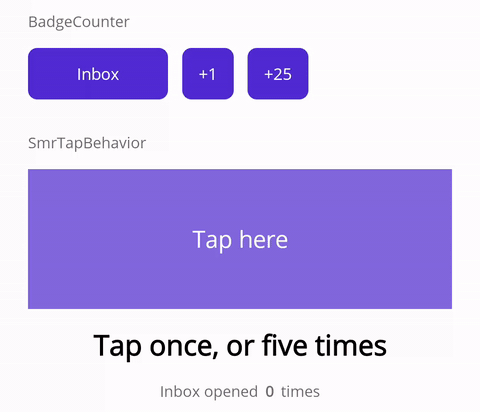
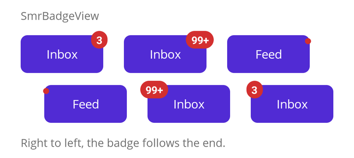
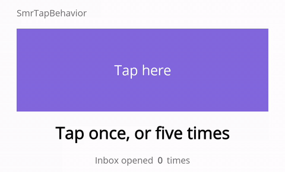

# SumireCraft.Maui

Fills the gaps .NET MAUI leaves to every application -- without taking a decision away from yours.



.NET 10 with .NET MAUI 10.0.20+ · Android 21+ · iOS 15+ · Mac Catalyst 15+ · Windows 10 1809+ · trimming and Native AOT compatible · MIT

## What it solves

| | | What .NET MAUI leaves to you |
| --- | --- | --- |
| **UI** | [SmrBadgeView](#smrbadgeview) -- a count or a dot over the corner of any view | A badge that stays on the content's own corner, mirrors for right-to-left, and never pushes the layout around as the count grows. |
| **Input** | [SmrTapBehavior](#smrtapbehavior) -- a different command for one tap, a double tap, or five | A single-tap recognizer fires on the way to a double tap. This reads the whole burst once, is safe in a `Style`, and its bindings resolve. |
| **Reliability** | [Exception reporting](#exceptions) -- one place to send every exception you catch | .NET MAUI catches nothing on an application's behalf. Log it, show it, or forward it to your crash reporter, from one place. |
| | [Safety net](#the-safety-net) (opt-in) -- reports what nothing caught, as far as .NET hears of it | A throw on a background task can take the process down without a trace. |
| | [Busy gate](#busy-gate) -- is anything in flight, anywhere in the app? | `AsyncRelayCommand` guards one command. The gate spans commands, pages and layers. |

### What gets in, and what stays out

Everything here fills a gap that .NET MAUI leaves to every application, and leaves the decisions to
yours. Nothing changes what your application does unless you ask: adding a widget never switches on
anything app-wide. Some things stay out on purpose -- an alert that shows exceptions to the user, a
weaver that writes `try`/`catch` for you -- because no two applications agree on them.

## Packages

| Package | Description |
| --- | --- |
| `SumireCraft.Maui.Controls` | The widgets. This is the package you normally want. |
| `SumireCraft.Maui.Core` | Exception reporting and the safety net, the busy gate, badge counting and lifetime helpers. Useful on its own, without any of the widgets. |

Core is for .NET MAUI applications, and depends on .NET MAUI itself (`Microsoft.Maui.Controls`),
since it plugs into `MauiAppBuilder`. A library that is not a .NET MAUI project -- a networking
layer shared with an ASP.NET Core server, say -- takes .NET MAUI along with it if it references
Core for the busy gate. A package of the parts that need no .NET MAUI is not planned for now.

## Install

```
dotnet add package SumireCraft.Maui.Controls
```

If you only want the common building blocks:

```
dotnet add package SumireCraft.Maui.Core
```

Both packages also target plain `net10.0`, so an application's unit test project can reference them.

## Usage

Initialize in `MauiProgram.cs`.

```csharp
using SumireCraft.Maui.Controls;

public static MauiApp CreateMauiApp()
{
    var builder = MauiApp.CreateBuilder();
    builder
        .UseMauiApp<App>()
        .UseSumireCraft();

    return builder.Build();
}
```

`UseSumireCraft()` calls `UseSumireCraftCore()` internally, so there is no need to call both.
If you reference only `SumireCraft.Maui.Core`, use `UseSumireCraftCore()`.

```csharp
using SumireCraft.Maui;

builder.UseSumireCraftCore();
```

**Only the first call on a builder counts.** Calling both, or one of them twice, registers nothing
twice. A later call that passes options throws an `InvalidOperationException`, since they could
only be dropped, so pass every option to the first call -- and watch for one made earlier by an
extension method of your own or another library's.

| Package | Namespace |
| --- | --- |
| `SumireCraft.Maui.Core` | `SumireCraft.Maui`, plus one per feature: `.Badges`, `.Exceptions`, `.Gates`, `.Lifetime`, `.Taps` |
| `SumireCraft.Maui.Controls` | `SumireCraft.Maui.Controls`, all of it, so one `xmlns` reaches every widget |

In XAML, that one `xmlns` is a URI:

```xml
xmlns:smr="https://github.com/startbits/SumireCraft.Maui"
```

The URI only names the library; nothing is downloaded from it. The `clr-namespace` form,
`clr-namespace:SumireCraft.Maui.Controls;assembly=SumireCraft.Maui.Controls`, works as well.

## Widgets

### SmrBadgeView

Puts a small badge over one corner of whatever it wraps.



```xml
xmlns:smr="https://github.com/startbits/SumireCraft.Maui"

<smr:SmrBadgeView Text="7">
    <Button Text="Inbox" />
</smr:SmrBadgeView>
```

What goes inside is the thing being badged. A badge can be shown with nothing inside as well, but it
then has no room of its own: it hangs from the corner of an empty space, wherever the layout puts
that, and is drawn over whatever lies around it. Placing a badge shown on its own is up to you,
with `Offset` or the layout around it. A badge with nothing to say is not drawn, so binding `Text`
to something that comes back empty removes the badge and leaves the layout where it was.
What the badge says arrives already decided: whether ninety-nine hundred should read `99+`, or a
zero should show nothing, belongs to whoever works the number out.

`BadgeCounter`, in `SumireCraft.Maui.Core`, is that decision ready made. Give it a count and it
offers `Text` and `IsVisible` to bind to: nothing at zero, the number itself up to 99, and `99+`
beyond. Both rules can be changed when it is made.

```csharp
using SumireCraft.Maui.Badges;

public BadgeCounter Badge { get; } = new(maxCount: 9);   // 10 reads "9+"
// new BadgeCounter(showZero: true) keeps a zero on show

Badge.Count = unread.Count;   // Text and IsVisible follow
```

`Count` is the one thing to set. A negative count is taken as zero. The change is announced on the
thread that set it, so set it on the main thread. The number is written in the digits 0 to 9,
whatever the application's culture; an application that wants other digits works the text out
itself and binds `Text` to that.

```xml
<smr:SmrBadgeView Text="{Binding Badge.Text}">
    <Button Text="Inbox" />
</smr:SmrBadgeView>
```

Bind `Text` alone. A hidden counter's text is empty, and that is already enough to take the badge
away; `IsVisible` on `SmrBadgeView` would hide the button along with it.

Everything about how the badge looks can be said outright, and all of it has a default that suits
a notification count.

```xml
<smr:SmrBadgeView Text="NEW"
              Placement="TopEnd" Offset="8,-8"
              Fill="MidnightBlue" Stroke="White" StrokeThickness="2"
              CornerRadius="12,15,18,20">
    <smr:SmrBadgeView.BadgeShadow>
        <Shadow Brush="Black" Opacity="0.5" Offset="4,4" Radius="8" />
    </smr:SmrBadgeView.BadgeShadow>
    <Button Text="Drafts" />
</smr:SmrBadgeView>
```

| Property | Default | |
| --- | --- | --- |
| `Text` | empty | What the badge says. The built-in badge is not drawn while it is empty. |
| `IsBadgeVisible` | `true` | Shows or hides the badge alone, not what it wraps. |
| `Placement` | `TopEnd` | The corner. |
| `Offset` | `0,0` | How far to move the badge on from that corner. |
| `Fill` | `#D32F2F`, a red | What the badge is filled with. |
| `Stroke` | none | Its outline. |
| `StrokeThickness` | `0` | How thick the outline is. |
| `CornerRadius` | `12` | Enough to make a short badge a pill. |
| `TextColor` | `White` | |
| `FontSize` | `12` | |
| `FontAttributes` | `Bold` | A badge is small and read at a glance. |
| `FontFamily` | the platform's | |
| `TextFlowDirection` | `LeftToRight` | Which way the text runs: left to right, even on a right-to-left page. |
| `BadgePadding` | `6,2` | Between the text and the edge of the badge. |
| `BadgeShadow` | none | The shadow the badge casts. |
| `BadgeTemplate` | none | Draws the badge from a template instead of the label. |

`Placement` is the corner: `TopEnd` (the default), `TopStart`, `BottomEnd` or `BottomStart`. Start
and end rather than left and right, so a layout mirrored for a right-to-left language puts the
badge where the reader expects it. By default a quarter of the badge hangs out past each edge of
that corner, where Material 3 puts a badge with text. `Offset` moves it on from there without
making the whole thing any bigger. It turns with the corner: a positive X points towards the end,
so `8,-8` hangs a top-end badge further out to the right in a left-to-right page and further out
to the left in a right-to-left one.

The corner turns with the page and the text does not. Laid out right to left, `99+` would read
`+99`, because a plus sign at the end of a right-to-left paragraph moves to its other end; so the
badge's text runs left to right whichever way the page does. A word in a right-to-left script still
reads as it should in a left-to-right badge; only the punctuation at its ends could move.
`TextFlowDirection="MatchParent"` lets the text follow the page instead.

The badged thing is the size of what it wraps, however far the badge hangs out. So whatever clips
the content -- the edge of a scroll view, a cell in a collection view -- clips the badge with it,
and a view laid out after it in the same layout is drawn over the part of the badge that reaches
it. Leave space between them, or give the `SmrBadgeView` a higher `ZIndex` than its neighbour.

The properties `SmrBadgeView` inherits keep their usual meaning. `HorizontalOptions` places the
whole badged thing in its own parent, and `Shadow` is the shadow the whole badged thing casts; the
badge has `Placement` and `BadgeShadow` of its own. `Fill` rather than `Background`, and
`BadgePadding` rather than `Padding`, for the same reason.

A badge need not be a label. `BadgeTemplate` puts anything in the corner instead -- a dot, an
image -- and `SmrBadgeView` still places it, offsets it and casts its shadow.

```xml
<smr:SmrBadgeView IsBadgeVisible="{Binding Badge.IsVisible}">
    <smr:SmrBadgeView.BadgeTemplate>
        <DataTemplate>
            <Ellipse Fill="Red" WidthRequest="10" HeightRequest="10" />
        </DataTemplate>
    </smr:SmrBadgeView.BadgeTemplate>
    <Button Text="Feed" />
</smr:SmrBadgeView>
```

A dot has no text to fall silent, so `IsBadgeVisible` is what shows and hides it, and a counter's
`IsVisible` is what to bind there. The label's own properties -- `Text`, `Fill`, the font and the
rest -- describe the label, and leave a templated badge alone. It is a template rather than a
view so that one style can give every badge in an application the same look.

The template's root must be a view, and `SmrBadgeView` places it. Its `HorizontalOptions`,
`VerticalOptions`, `Margin`, `Shadow` and `IsVisible` are set from `Placement`, `Offset`,
`BadgeShadow` and `IsBadgeVisible`, and whatever the template says for them is overwritten. A
template that wants them for itself wraps its content in a layout and sets them there.

Pressing the built-in badge presses what it marks. A templated badge takes presses as its template
says, and on Windows a view with a background can keep a press for itself, leaving the corner
under it dead. A template that should let presses through sets `InputTransparent="True"`
on its root.

Leave `ControlTemplate` as it is. It is the whole badged thing, not the badge, and replacing it
takes every property above with it.

A type of your own can derive from `SmrBadgeView`. Set properties in its constructor to change the
defaults, set `BadgeTemplate` there to change the look, or override `CreateDefaultBadge()` to
change the look while leaving `BadgeTemplate` free for whoever uses your type.

### SmrTapBehavior

Runs a different command depending on how many times a view was tapped.



```xml
xmlns:smr="https://github.com/startbits/SumireCraft.Maui"

<Image Source="logo.png">
    <Image.Behaviors>
        <smr:SmrTapBehavior>
            <smr:SmrTap Count="1" Command="{Binding OpenInboxCommand}" />
            <smr:SmrTap Count="5" Match="AtLeast" Command="{Binding OpenDebugRoomCommand}" />
        </smr:SmrTapBehavior>
    </Image.Behaviors>
</Image>
```

A burst of taps is read as a whole, once, when the tapping stops. Five taps open the debug room
without the inbox opening on the way there, and carrying on past five does not open it a second
time. Two or three taps open neither, because the inbox line asks for exactly one, and to someone
who taps twice out of habit the image looks dead. `Match="AtLeast"` on the inbox line opens the
inbox for anything short of five instead, and five still open the debug room. `Interval` is how long
a burst waits for another tap before it is read, in milliseconds, and defaults to 300; zero or less
is taken as 300 too.

`Count` is the number of taps a line is interested in, one by default, and `Match` is `Exactly`
(the default) or `AtLeast`. Where several lines match, the one asking for the most taps wins; where
an exact line and an at-least line ask for the same number, the exact one wins. A burst that
matches nothing does nothing.

The winning line is the only one asked. If its command's `CanExecute` says no, the burst does
nothing. It is not handed down to a line asking for fewer taps: with a line for at least one tap
and a line for exactly five, five taps whose command cannot run do not run the other one instead.
A view that wants a fallback says so with a command that decides for itself.

A burst being counted is finished, and the winning command run, even if the behavior is taken off
the view or the view leaves its page before the tapping stops. That is no different from any other
control whose work outlives its page; a command that must not run by then checks for that itself.

An exception thrown by a command is neither caught nor reported here. Like any exception thrown on
the main thread with nothing to catch it, it can end the application, so a command catches its
own and reports them to the sink, as [Exceptions](#exceptions) shows.

**If you only want to know that a view was tapped, use MAUI's own `TapGestureRecognizer`.** Counting
taps means waiting to find out whether more are coming, and there is no reason to pay for that wait
where there is nothing to count.

One line asking for `AtLeast` one tap is the exception worth knowing about. It answers a whole run
of taps once, when the run ends, which is what a view that must not be acted on twice wants.

**Not on a `Button`.** The behavior is meant for views that do not answer taps themselves -- a
label, an image, a border. A button, or anything else that answers taps on its own, is not
supported: what happens when both count the same taps is up to the platform, and may change with
.NET MAUI. With .NET MAUI 10, a button's own `Command` stopped running on Android, both ran on
Windows, and on iOS and Mac Catalyst the button's `Command` ran and the behavior's did not.

One behavior can be put on several views, so it is safe to write in a `Style`, which attaches the
same instance to every view the style is applied to. Each view counts its own taps, and a line's bindings
resolve against the view that was tapped, so `CommandParameter="{Binding .}"` hands over that
view's item. A `BindingContext` set on the behavior itself is used for every view instead.

### Wrapping a widget in a type of your own

No public widget is sealed. Derive `AbcTapBehavior` from `SmrTapBehavior` and `AbcTap` from
`SmrTap`, use only your own types in your pages, and replacing this library one day is one change
per type rather than one per page. The sample's
[`Wrapping/`](samples/SumireCraft.Maui.Sample/Wrapping) folder shows how.

## Exceptions

.NET MAUI catches nothing on an application's behalf. SumireCraft gives it one place to send the
exceptions it catches, and a net for the ones it does not.

`UseSumireCraftCore()` registers an `IExceptionSink`. What the sink does with a report is up to the
handlers the application registers, and every handler sees every report, in the order it was
registered:

```csharp
using SumireCraft.Maui.Exceptions;

builder.Services.AddSingleton<IExceptionHandler, LoggingExceptionHandler>();
builder.Services.AddSingleton<IExceptionHandler, AlertExceptionHandler>();   // your own
```

Register `LoggingExceptionHandler` first, so a failure is on record whatever the handlers after it
do. On record means in whatever your logger writes to, and .NET MAUI's template gives the logger
somewhere to write only in a Debug build with a debugger attached (`AddDebug()` inside
`#if DEBUG`). Anywhere else it logs nowhere until you add a provider of your own -- a file, or your
crash reporter's.

A handler that throws does not stop the ones behind it, and its failure never reaches the code that
reported: reporting a problem cannot become a second one. Nor is that failure reported anywhere, so
a handler that throws shows only in what it failed to do. A handler runs on whichever thread
reported, which may not be the main thread, so one that touches the user interface marshals first.

Inject the sink and report what you catch:

```csharp
private async Task SaveAsync()
{
    try
    {
        await _repository.SaveAsync(_cancellation.Token);
    }
    catch (OperationCanceledException) when (_cancellation.IsCancellationRequested)
    {
        // Cancelled on purpose. Nothing failed.
    }
    catch (Exception exception)
    {
        _sink.Report(new ExceptionReport(exception, ExceptionOrigin.Command, nameof(SaveAsync)));
    }
}
```

The filter on the first `catch` asks about the token, not the exception. A timeout throws an
`OperationCanceledException` too, finds the token untouched, and is reported like any other
failure; a `catch` that swallows every cancellation makes timeouts disappear without a trace.

`ExceptionOrigin` tells a handler what was going on. `Command` means somebody asked for something
and is waiting for an answer, `Background` means nobody is, and `Unhandled` means nothing caught
it. That is usually what a handler decides on: an alert is right for a failed command and wrong for
a failed background sync.

Code that cannot have the sink injected -- a static helper, an event handler on a view nothing
built through the container -- reports to the same sink through `SumireCraftExceptions`:

```csharp
SumireCraftExceptions.Report(exception, ExceptionOrigin.Background, nameof(Refresh));
```

No handler that shows anything to the user ships with the library, because no two applications
agree on what an alert should say. The sample's
[`AlertExceptionHandler`](samples/SumireCraft.Maui.Sample/Exceptions/AlertExceptionHandler.cs) is one
to start from, and says why it does each thing it does.

SumireCraft ships no aspect, weaver or source generator to write the `try`/`catch` around every
command for you; each asks something of the application's build that a library should not decide.

### The safety net

The safety net is off until you turn it on:

```csharp
builder.UseSumireCraft(options => options.InstallSafetyNet = true);
```

It listens to `AppDomain.UnhandledException`, `TaskScheduler.UnobservedTaskException` and, on
Windows, the WinUI application's own event, and reports what it hears as `Unhandled`. It only
records: it never marks an exception handled, and it never keeps alive an application that was
about to die. It is off by default all the same, because those events belong to the whole process.
What it hears goes to your handlers like any other report, so with no handler registered it
records nothing.

It hears only what those events carry, so not every failure is caught. A crash in native code, or
the operating system stopping the application, ends it without raising any of them, and nothing is
reported.

`UnobservedTaskException` is raised only when the garbage collector finalizes a failed task whose
exception nobody observed, by awaiting it or otherwise. That can be long after the failure, or
never, if the process ends first. A task started and not awaited is better given a `try`/`catch`
of its own that reports to the sink.

Leave it off when a crash reporter such as Sentry already owns those events. The sink still has a
part to play there: what you catch reaches the crash reporter through it, wherever you caught it.
If the reporter already turns error logs into events, as Sentry.Maui does by default,
`LoggingExceptionHandler` is all it takes; a handler that forwards each report to it as well sends
everything twice.

## Busy gate

`IBusyGate` answers one question: is anything in flight? The usual reason to ask is to keep a
second tap on a button from starting the same work twice.

`AsyncRelayCommand` in CommunityToolkit.Mvvm already keeps one command from running twice. The gate
answers a wider question, once for the whole application: work started by a button, a
pull-to-refresh or a networking layer is visible to every page that asks.

```csharp
using SumireCraft.Maui.Gates;

private async Task RefreshAsync()
{
    if (_gate.IsBusy)
    {
        return;
    }

    using (_gate.Enter(this))
    {
        await LoadAsync();
    }
}
```

The gate never blocks anyone; what to do with the answer is the caller's decision.
`UseSumireCraftCore()` registers one gate for the whole application, so work started in a
networking layer is visible to the page as well -- and so this button also does nothing while
unrelated work is in flight elsewhere. If only the command's own run should hold it back,
`AsyncRelayCommand` alone is enough; reach for the gate when the wider answer is the one you want,
and give work that should not hold everything else back a gate of its own, as below. Owners are
held weakly, so one that is collected without leaving stops counting and keeps nothing alive.

`BusyChanged` says only that something changed; ask `IsBusy` for the answer. Two changes can reach a
handler in either order, so a handler that kept track of them one by one could end up wrong, while
the property never is. The event is raised on whichever thread caused the change, so a handler that
touches the user interface marshals first and asks once it is there:

```csharp
_gate.BusyChanged += OnBusyChanged;

private void OnBusyChanged(object? sender, EventArgs e) =>
    MainThread.BeginInvokeOnMainThread(() => IsRefreshing = _gate.IsBusy);
```

The gate lives as long as the application and, like any event, keeps its handlers alive. A page or
view model that subscribes unsubscribes when it is done.

A gate that never goes idle -- usually an exit that was never reached -- leaves every button that
asks it dead. Give it a timeout and a `BusyWatchdog` clears it, then reports a
`BusyTimeoutException` as `Background`, so the rescue does not hide the bug:

```csharp
builder.UseSumireCraft(options => options.BusyTimeout = TimeSpan.FromSeconds(30));
```

The watchdog measures the gate as a whole. Work that keeps it busy for longer than that on purpose,
an upload say, belongs in a gate of its own.

A second gate is a `BusyGate` of your own, registered under a key so that it stays apart from the
application's gate. Give it a watchdog with a timeout that suits its work, or none:

```csharp
using SumireCraft.Maui.Exceptions;
using SumireCraft.Maui.Gates;

builder.Services.AddKeyedSingleton<IBusyGate>("uploads", (services, _) =>
{
    var gate = new BusyGate();

    // Nothing else holds the watchdog: the gate keeps it alive through BusyChanged, for as long
    // as the gate itself lives.
    _ = new BusyWatchdog(gate, TimeSpan.FromMinutes(10), services.GetRequiredService<IExceptionSink>());

    return gate;
});
```

Code that works with uploads asks for that gate by its key, and everything else keeps getting the
application's gate:

```csharp
public sealed class UploadViewModel([FromKeyedServices("uploads")] IBusyGate uploads)
{
    // ...
}
```

`UseSumireCraft()` registers the application's gate without a key, so the two can be registered in
either order.

## Building blocks

Smaller pieces the features above are built from, published because they are useful on their own.

- `WeakReferenceList<T>`, in `SumireCraft.Maui.Lifetime`, tracks objects without keeping them
  alive. Entries for collected objects stay until `Purge()`, so nothing changes behind your back.
- `TapSequence`, in `SumireCraft.Maui.Taps`, holds the rules `SmrTapBehavior` reads a burst by,
  with no views or gestures. It is given a list of `ITapTrigger` -- the lines, which `SmrTap`
  implements -- and an interval in milliseconds. Call `Tap()` for each tap, and once the tapping
  stops `Triggered` hands back the trigger that won, on the clock's thread rather than the one
  that tapped. Dispose it to drop a burst in progress and stop the clock. `TapMatch`, which C#
  code setting `SmrTap.Match` needs, is in the same namespace.
- `InheritBindingContextFrom()`, an extension method in `SumireCraft.Maui`, keeps a bindable
  object's binding context in step with a view's. .NET MAUI does not pass a view's binding context
  to a behavior or to anything a behavior holds, so a `{Binding}` there resolves to nothing without
  it.

  It returns an `IDisposable`, a link that keeps following until it is disposed, and the view
  holds on to the follower until then. Dispose it when the behavior detaches:

  ```csharp
  using SumireCraft.Maui;

  private IDisposable? _context;

  protected override void OnAttachedTo(View bindable)
  {
      base.OnAttachedTo(bindable);
      _context = this.InheritBindingContextFrom(bindable);
  }

  protected override void OnDetachingFrom(View bindable)
  {
      _context?.Dispose();
      _context = null;
      base.OnDetachingFrom(bindable);
  }
  ```

  A behavior that can be on several views at once, as one in a `Style` is, needs one link per
  view; a single field like this one is overwritten by the second view.

## Supported versions

| Package | Built for | .NET MAUI |
| --- | --- | --- |
| 1.x | .NET 10 | 10.0.20 or later |

NuGet lets a .NET 11 application install 1.x too, because a newer .NET can use a package built for
an older one, but it has not been tried there yet.

- **The version is the library's own.** It follows [Semantic Versioning](https://semver.org/) and
  does not line up with .NET or .NET MAUI: 1.1 is not built for any particular .NET MAUI 10.0.x.
  A fix comes in a patch release, a new feature in a minor one.
- **The major version goes up for breaking changes, and only for them.** Dropping a .NET is one.
- **A new .NET joins the one before it.** Support for a new .NET comes in a minor release, and
  the same package keeps the .NET before it at least until Microsoft's
  [support for that .NET MAUI](https://dotnet.microsoft.com/platform/support/policy/maui) ends,
  and possibly longer. That support is shorter than the .NET it runs on: a .NET MAUI version's
  support ends six months or so after the next one ships, even on a long-term support .NET.
- **Core is released only when it changes.** Both packages take their numbers from one sequence:
  Controls takes every one, Core only those of releases that change it. So Core can skip numbers
  (1.0.1, then 1.0.3), Controls is never behind it, and each Controls release asks for the Core
  it was built with or later, up to the next major version of Controls: Controls 1.x takes
  Core 1.x only. Referencing a newer Core than that directly gets a warning (NU1608) from NuGet.
- **The .NET MAUI version is a minimum.** A minor release may raise it, and the
  [changelog](CHANGELOG.md) says so in that release's entry.
- **Fixes go to the latest release only.** An earlier major version is not patched, so taking a
  fix can mean taking a new major version's breaking changes with it.

In short: an application that stays on .NET 10 can take the latest release, and so its fixes, at
least until Microsoft's support for .NET MAUI 10 ends, which comes some months after .NET 11 ships
and well before .NET 10's own long-term support runs out. After that, a fix may come only in a
release that needs a newer .NET.

### Where it has been run

| Platform | Run on |
| --- | --- |
| Android | An emulator (Android 16, API 36) |
| iOS | iPhone simulators (iOS 26.5 and 27.0) |
| Mac Catalyst | A Mac (macOS 27.2) |
| Windows | A Windows 11 PC |

Nothing has been run on a phone or a tablet.

## Feedback

Every report is welcome, however it is put: a bug, a surprise, a page of this README that left you
guessing, or just "this was annoying". You do not need to know how to fix it -- what happened to
you is what helps. Open an issue, and thank you for taking the time.

SumireCraft.Maui is kept by one person, so a fix can take a while to arrive. Every report is read.

## License

[MIT](LICENSE). What changed in each version is in the [changelog](CHANGELOG.md).
